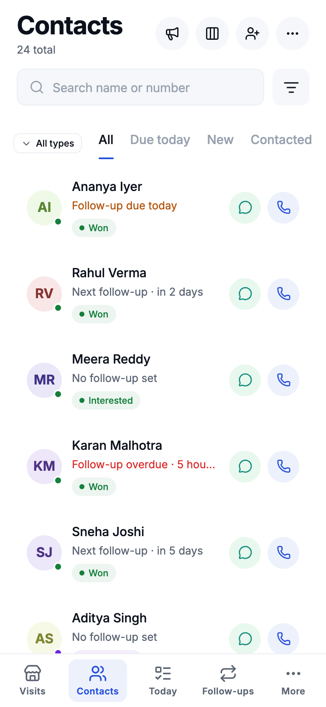
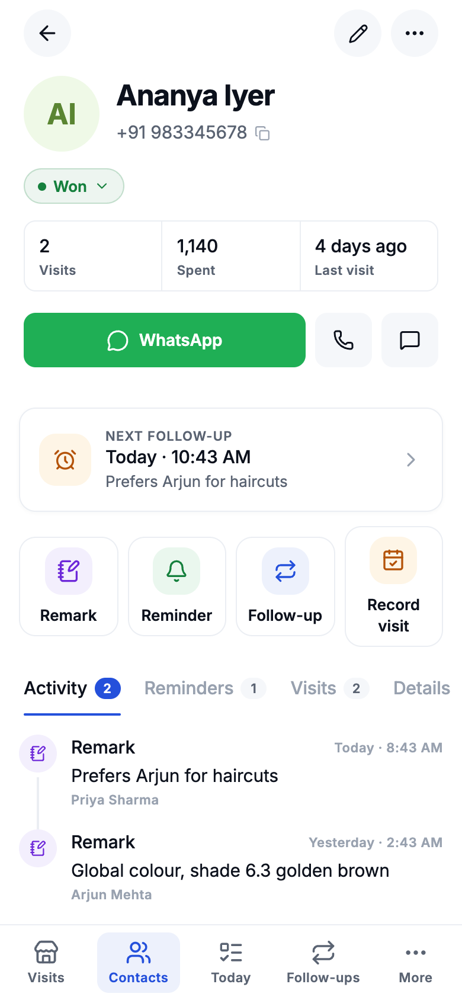
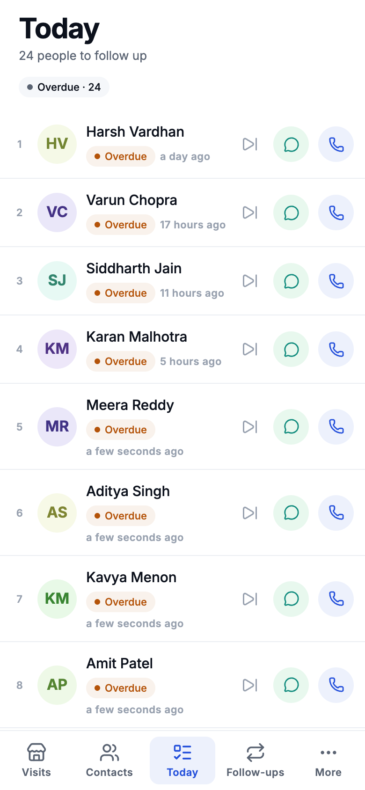
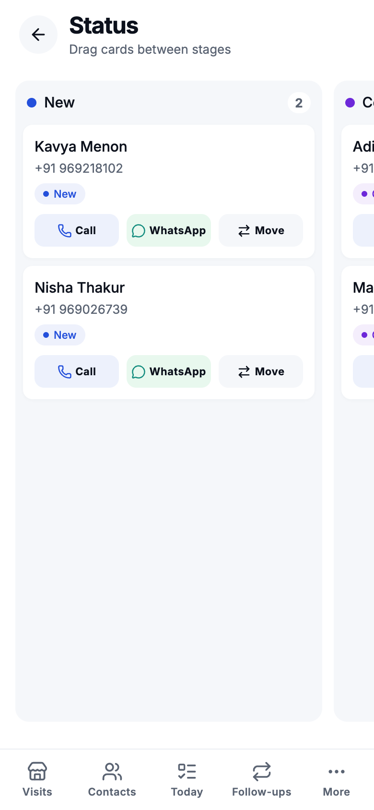
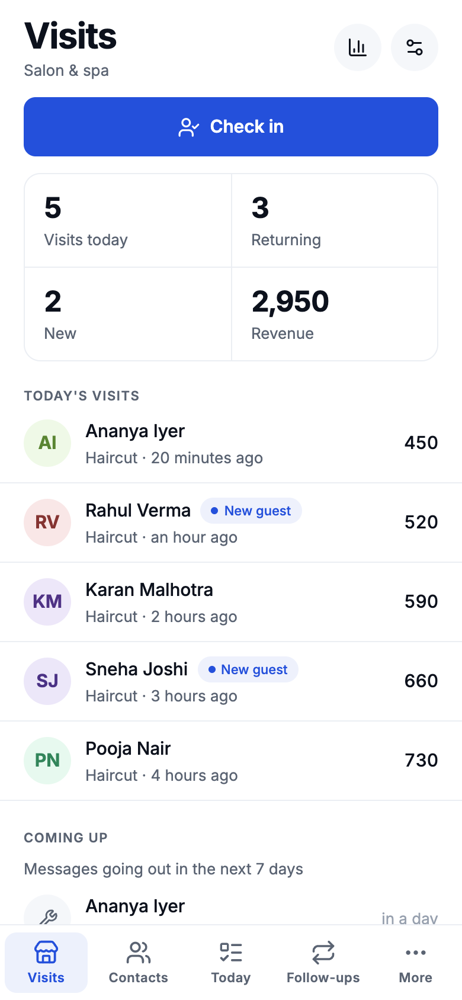

<div align="center">


# Followups CRM

**A WhatsApp follow-up CRM for small businesses.** Leads, follow-up reminders, customer visits and WhatsApp automation, on **Android, iPhone and the web**.

</div>

<p align="center">
  
  
  
  
  
</p>

Most small businesses lose sales because they forget to follow up. In Followups CRM every lead has a next follow-up date, the **Today queue** shows the team who to message, **automatic WhatsApp follow-up series** do the sending, and **visit tracking** brings customers back. It works with the **WhatsApp Business API** or the **normal WhatsApp app**.

## Backend and the Com Bot Partner Program

> **This repository is the frontend only.** It contains the source of the mobile and web app. It needs a backend to work, and the backend is provided by **Com Bot AI Limited** through the **Com Bot Partner Program**.

The app talks to two hosted services through two npm packages:

| Package | Service | Used for |
| --- | --- | --- |
| [`@ab-ecosystem/sso`](https://www.npmjs.com/package/@ab-ecosystem/sso) | **SSO** (Auth-as-a-Service) | Sign-in, two-factor, teams, members and roles |
| [`@ab-ecosystem/cpaas`](https://www.npmjs.com/package/@ab-ecosystem/cpaas) | **CPaaS** gateway | Contacts, WhatsApp Business API, templates, campaigns, wallet and the cloud data store |

The packages are free and MIT licensed, but they only connect to the Com Bot backend. To run your own branded copy of Followups CRM:

1. **Sign up with Com Bot as a partner** on the Com Bot Partner Program: [udghatan.com/developer-sdk/products/cpaas-platform](https://udghatan.com/developer-sdk/products/cpaas-platform/).
2. Once approved, you get access to the **SSO panel** and the **CPaaS gateway**, where you create your project, add users, connect WhatsApp numbers and set data store plans.
3. Put the SSO URL, CPaaS gateway URL and Access ID you receive into `.env` (see [Initial setup](#initial-setup)).

As a partner you sell the app under **your own brand**: you own the customer relationship and set your own prices, and Com Bot runs the backend.

## Initial setup

The app runs on a hosted backend: an **SSO** service for sign-in and teams, and a **CPaaS** gateway for contacts, WhatsApp and the cloud data store. You get both by joining the [Com Bot Partner Program](#backend-and-the-com-bot-partner-program).

1. **Get your backend details.** After you are approved as a Com Bot partner, create a project in your SSO panel and note the **SSO URL**, the **CPaaS gateway URL** and the project's **SDK project id** (the Access ID).
2. **Install:**

   ```bash
   git clone <this-repo> followups-crm && cd followups-crm
   npm install
   cp .env.example .env
   ```

3. **Fill in `.env`.** Every variable is explained in [.env.example](.env.example). At least:

   ```bash
   EXPO_PUBLIC_SSO_URL=https://sso.example.com
   EXPO_PUBLIC_CPASS_BASE_URL=https://cpaas.example.com
   EXPO_PUBLIC_APP_NAME="Your CRM"
   EXPO_PUBLIC_ANDROID_PACKAGE=com.yourcompany.crm
   EXPO_PUBLIC_ACCESS_ID=your-sdk-project-id
   ```

   **Set `EXPO_PUBLIC_ACCESS_ID` to your SDK project id** so users go straight to the login screen and never have to type or scan an Access ID. Leave it empty only if one app should serve several businesses, each entering its own Access ID.
4. **Set your brand:** name, colour and logo (see [Your own brand](#your-own-brand)).
5. **Add push notifications:** fill the `EXPO_PUBLIC_FIREBASE_*` values and replace `google-services.json` and `GoogleService-Info.plist` with your own Firebase files.
6. **Run it:** `npx expo start --web` for the web app, or build a test APK (see [Build and publish](#build-and-publish)).
7. **Set up data store plans** in the backend (next section).
8. **Add users** in the SSO panel, each with their own email and password. There's no sign-up screen and no in-app invites. If you didn't set `EXPO_PUBLIC_ACCESS_ID`, share the Access ID with them as text or a QR code.

On first sign-in, the workspace owner goes through a short **Workspace setup**: create the lead fields, then pick a data store plan. Nothing is created automatically. Team members see a banner until the owner finishes, and the owner sets each member's role in **Settings → Members**.

### Data store plans

The app keeps remarks, reminders, visits and follow-up series in a **cloud data store**, one per workspace. You set the plans and prices in the backend; the app itself sells nothing.

- In the project's **data store resource**, add one or more plans with storage and request limits, free or paid, and for paid plans **a price for each tenure** (30, 90, 180, 360 days…).
- A workspace only sees prices for **its main plan's tenure**, so add a price for every tenure your main plans are sold on. If none matches, the owner is told to contact their admin.
- Check each main plan's **data store allowance**. Paid plans are charged to the workspace's **CPaaS wallet**.

## Features

- **Leads:** status, type, product, priority, deal value, notes and next follow-up date; segments, tags, filters, Kanban boards; import from Excel/CSV or phone contacts.
- **Follow-ups:** reminders with notifications, a ranked Today queue, and automatic follow-up series started by a new lead, a status change or a visit.
- **WhatsApp:** with the Business API, approved templates, bulk campaigns with delivery stats and scheduled messages; without it, buttons open WhatsApp with the text filled in.
- **Visits:** quick check-in, staff tracking, industry templates (restaurants, salons, clinics, gyms, retail and more), thank-you, recall, win-back and birthday messages, and revenue reports.
- **Teams:** roles, per-feature permissions, "own leads only" scope, round-robin lead assignment, several workspaces on one device.
- **17 languages** (right-to-left for Arabic and Urdu), light and dark themes.

## Your own brand

Nothing brand-specific is hardcoded. The app name, brand name, colour, store ids and Firebase config all come from `.env`, and every language picks up the name. Replace the icon and logo images too; the full checklist is in [docs/REBRANDING.md](docs/REBRANDING.md).

### Rebrand with an AI coding agent

Open the project in an AI coding agent (such as Claude Code or Cursor), attach your logo if you have one, and paste this prompt with your brand name:

```text
Rename the app to the brand name "Followups CRM".
Use the attached logo. If no image is attached, create your own logo.
Set the default colour to match the brand colours.
Follow docs/REBRANDING.md: update the brand values in .env, replace the icon, splash and logo images
(same file names and sizes), then run `npx expo config`, lint and typecheck to confirm the new name and ids.
```

## Build and publish

Builds run in the cloud with EAS, so you don't need Android Studio or Xcode. Set `EAS_PROJECT_ID` and `EAS_OWNER` in `.env` first (`npx eas-cli@latest init` creates the project).

| Target | Command |
| --- | --- |
| Android test APK | `npx eas-cli@latest build -p android --profile preview` |
| Google Play (AAB) | `npx eas-cli@latest build -p android --profile production` |
| App Store | `npx eas-cli@latest build -p ios --profile production` |
| Web (static site in `dist/`) | `npm run build:web` |

Google Play and the App Store require an account-deletion page: set it in `EXPO_PUBLIC_DELETE_ACCOUNT_URL`. The page must name your app or company.

## FAQ

**Can I run it with my own backend?**
Not out of the box. This is frontend source code built on the `@ab-ecosystem/sso` and `@ab-ecosystem/cpaas` packages, which connect to the Com Bot backend. To get backend access, [join the Com Bot Partner Program](#backend-and-the-com-bot-partner-program). You can still try the app's screens without any backend (see the next question).

**Is this a WhatsApp Business API app?**
It supports both. With an API number connected you get templates, campaigns and fully automatic follow-ups, and replies are handled in the WhatsApp Business app. Without the API, the app prepares each message and the user taps send.

**Is there billing in the app?**
No. The only charge is a paid data store plan, which the owner picks in Workspace setup and CPaaS charges to the wallet.

**Can I try it without a backend?**
Yes: run `npx expo start --web` and open `http://localhost:8081/visits?preview=1` for a sample salon workspace with made-up data.

**Anything to know about captcha?**
On Android, captcha runs with the origin `http://localhost`, so add `localhost` to the captcha key's allowed domains.

**Are the translations reviewed?**
The non-English translations were machine-drafted. Have a native speaker check them before releasing in that language.

## License

[MIT](LICENSE).
